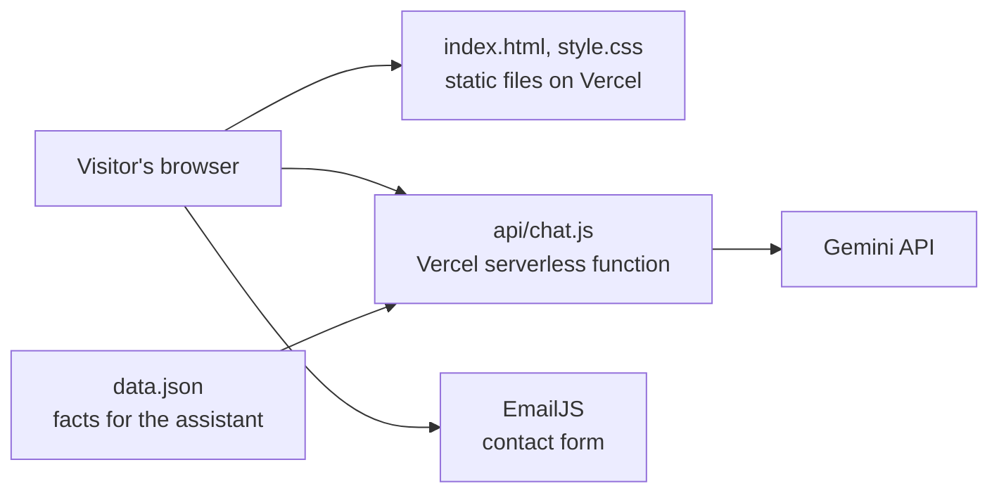

# Data Engineering Portfolio

The personal portfolio site of Ntokozo Ntombela, a graduate data engineer in Durban: projects, certifications, education and an AI chat assistant.

**[View the site](https://data-engineering-portfolio-xi.vercel.app/)**

## How it's built



- **Page:** a static `index.html` and `style.css`, with no build step.
- **Chat:** `api/chat.js` answers questions using the facts in `data.json`, and the instructions tell the model to say it doesn't know when something isn't there. It's still an AI model, so an answer can be wrong. It limits message length and requests per visitor, and it doesn't show error details to visitors.
- **Contact form:** sends through EmailJS from the browser. The EmailJS key in the page is meant to be public.

`index.html` is written by hand and doesn't read `data.json`, so a change to your projects or certifications needs updating in both files.

## Run it locally

You need [Node.js](https://nodejs.org/) and the [Vercel CLI](https://vercel.com/docs/cli), which runs the chat function locally.

```bash
git clone https://github.com/ntokozo078/data-engineering-portfolio.git
cd data-engineering-portfolio
npm install
vercel dev
```

Open the address it prints. To use the chat locally, add this to a file named `.env.local`, which git ignores:

```text
GEMINI_API_KEY=your-key
```

In production, `GEMINI_API_KEY` goes in the Vercel project's environment variables. Never commit it to git.

Run the chat tests, which need no key or network:

```bash
npm test
```

---

**Ntokozo Ntombela** · Graduate Data Engineer · Microsoft Certified: Fabric Data Engineer Associate (DP-700)
[LinkedIn](https://www.linkedin.com/in/ntokozo-ntombela-ba662235a) · [Portfolio](https://data-engineering-portfolio-xi.vercel.app/)
